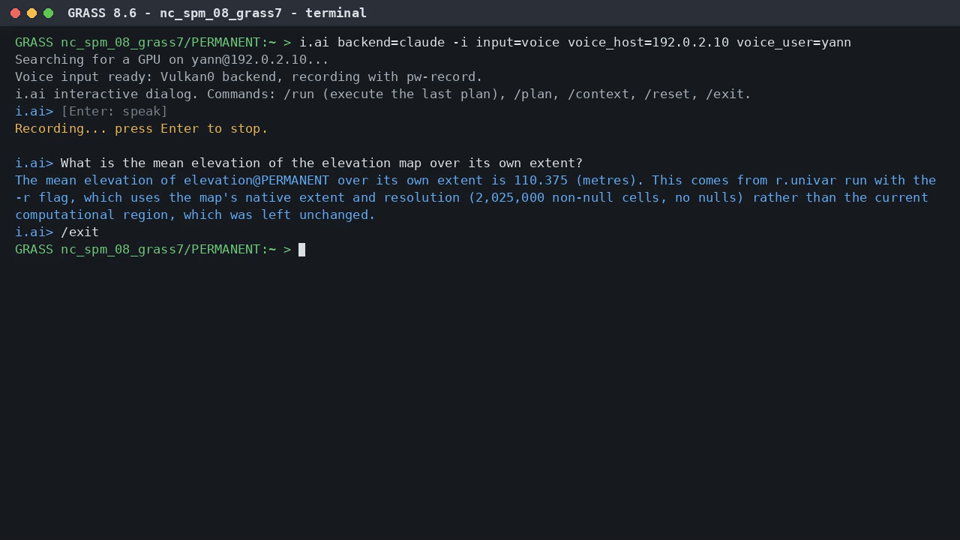
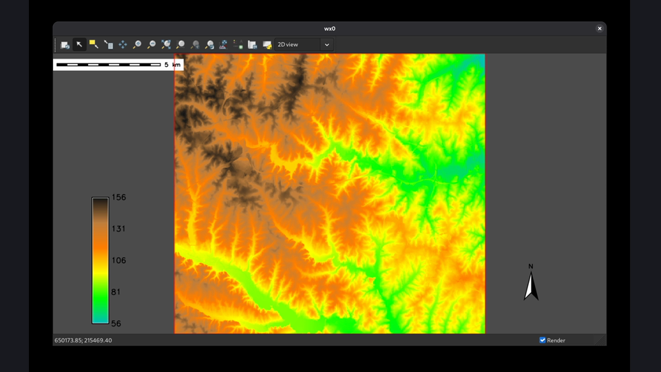

# i.ai

AI assistant for GRASS. It answers questions about the session, plans
GRASS commands and command-line steps that are validated before anything
runs, and writes complete report pipelines: numbered scripts, stored per
session, that go from the data to a LaTeX report, run end to end, repair
their own failing steps and compile the PDF. Every GRASS tool installed
in the session (core or addon) and every command-line tool on `PATH`
(GDAL, LaTeX, Graphviz, ImageMagick, pandoc, ...) is available to it.
Requests are typed, or spoken (`input=voice`) and transcribed by
whisper.cpp on a GPU: this machine's, or a GPU server's (`voice_host`,
`voice_user`), never on a CPU.

Backends: Ollama, any OpenAI-compatible server with an API key,
Blablador (Helmholtz AI, open for research and teaching), Claude Code (logged-in
`claude` command, no API key) and OpenCode (free `opencode/big-pickle`
model, no account).

The agent design follows [GeoCopilot](https://github.com/yosgi/GeoCopilot):
an intent agent routes each request to a clarification, query or
execution agent; these work in JSON steps with read-only tools; plans go
through a validation layer and only run with `-e`.

## Install

```sh
make MODULE_TOPDIR=$HOME/dev/grass           # build into the GRASS build tree
make MODULE_TOPDIR=$HOME/dev/grass install   # install into the GRASS it was built for
```

or, from a GRASS session, `g.extension i.ai url=$HOME/dev/i.ai` (user
addon). GRASS 8.6 searches its own `scripts` directory before the user
addons, so an older system-wide `i.ai` would still win over an addon
install: check with `which i.ai` inside the GRASS shell.

## Use

```sh
i.ai backend=claude query="What is the mean of elevation over its own extent?"
i.ai backend=opencode query="Compute slope in degrees from the DEM" -e
i.ai backend=claude query="Compute NDVI from the Landsat bands" format=shell > ndvi.sh
i.ai backend=claude operation=report workdir=~/Documents/LaTex/Report/20261017_Terrain \
     query="Terrain report of the elevation map: slope, streams, maps, figures, tables" -e -y
i.ai backend=claude workdir=... operation=run from_step=04 -e   # rerun, with repairs
i.ai backend=claude -i                 # interactive dialog
i.ai backend=claude -i input=voice voice_host=192.0.2.10 voice_user=yann   # spoken requests
i.ai operation=info                    # what the assistant sees
i.ai operation=index                   # cache every tool interface, index manuals
```

### Interactive dialog

From the GRASS shell:

```sh
i.ai -i backend=claude                  # interactive dialog with Claude
i.ai -i backend=claude model=sonnet     # pick the Claude model
i.ai -i backend=opencode                # free Big Pickle
i.ai -i backend=claude input=voice voice_host=<server> voice_user=<login>   # spoken requests
```

`backend=` chooses the language model service; `model=` picks a model
within it (`model=claude` alone is refused with a hint to use
`backend=claude`).

In the dialog, each plan is offered to run, and saying or typing *do it*
(or *yes*, *run it*, *vas-y*...) runs the last one. The dialog is also a
GRASS command line: a line starting with a GRASS tool (`d.mon
start=wx0`) runs directly, and a line starting with `!` runs a shell
command; both are validated first.

### Blablador (Helmholtz AI, for research and teaching)

[Blablador](https://sdlaml.pages.jsc.fz-juelich.de/ai/guides/blablador_api_access/)
is the Helmholtz AI service at Jülich, open for research and teaching.
Create a personal access token on [Helmholtz Codebase](https://codebase.helmholtz.cloud)
(user settings, `read_user` scope), save it in a private file, then:

```sh
chmod 600 ~/.blablador_key
i.ai -i backend=blablador api_key_file=~/.blablador_key                    # alias-large
i.ai -i backend=blablador model=alias-fast api_key_file=~/.blablador_key   # faster, higher rate limit
```

Or `export BLABLADOR_API_KEY=...` instead of `api_key_file=`. Any other
OpenAI-compatible service works the same way with `backend=openai
url=<base URL> model=<name>` and its key in `api_key_file=` or
`IAI_API_KEY`. i.ai checks the key and the model at start, waits out
rate limits (HTTP 429), and falls back to plain JSON prompting on
servers without structured output.

### OpenCode Big Pickle (free, no account)

```sh
i.ai -i backend=opencode                              # dialog with Big Pickle
i.ai -i backend=opencode model=opencode/big-pickle    # the same, model named explicitly
i.ai backend=opencode query="What is the mean elevation of the elevation map?"   # one question
i.ai -i backend=opencode input=voice voice_host=<server> voice_user=<login>      # spoken requests
```

Big Pickle is the default model of the `opencode` backend, used through
the `opencode` command as a guest: no account or login is needed. Each
model call starts the OpenCode command, so steps are slower than with
Claude (about 10 to 15 s per call). The free guest quota is limited: when
it is used up, OpenCode refuses the calls ("rate limit exceeded") and
i.ai says so within seconds; try again later or switch to
`backend=claude`.

See [i.ai.md](i.ai.md) for the full manual.

## Demos

Both videos are real runs on the North Carolina sample dataset: the
request is spoken into the microphone, transcribed by whisper.cpp on a GPU
server, and answered or executed by i.ai with Claude Code. Click a picture
to play its video.

### Spoken question, answered

*"What is the mean elevation of the elevation map over its own extent?"*
i.ai computes it with *r.univar* on the map's native extent and
resolution, without changing the computational region.

[](demos/voice_query/voice_query.mp4)

[voice_query.mp4](demos/voice_query/voice_query.mp4), 27 s, generated by
[make_demo.py](demos/voice_query/make_demo.py).

### Spoken request, drawn in a map display

*"Open a display window, show the elevation map with a legend, a north
arrow and a scale bar, wait three seconds, then close the display."*
i.ai plans and runs `d.mon start=wx0`, `d.rast`, `d.legend`,
`d.northarrow`, `d.barscale`, `sleep 3` and `d.mon stop=wx0`; the video
shows the real map display window, recorded while the plan ran.

[](demos/voice_map/voice_map.mp4)

[voice_map.mp4](demos/voice_map/voice_map.mp4), 54 s, generated by
[make_demo.py](demos/voice_map/make_demo.py).

Each `make_demo.py` regenerates its video from live runs, or from its
saved `capture.json` with `--reuse`; see the script's docstring.

## Files

| File | Role |
|---|---|
| `i.ai.py` | GRASS parser interface, output, plan execution |
| `iai_llm.py` | Backends (ollama, openai, claude, opencode) |
| `iai_catalog.py` | Live catalog of installed tools and their interfaces |
| `iai_registry.py` | Maps in the search path, fuzzy and synonym matching |
| `iai_validate.py` | Command parsing, validation and risk levels |
| `iai_context.py` | Session context, dialog history, saved sessions |
| `iai_tools.py` | Read-only tools the model calls |
| `iai_rag.py` | Manual page search (BM25, optional embeddings) |
| `iai_shell.py` | Command-line catalog, read-only probes, bash/Python validation |
| `iai_report.py` | Report workspaces: env, Makefile, run book, LaTeX, runner |
| `iai_voice.py` | Voice input: pw-record, GPU search, whisper-server over ssh |
| `iai_agents.py` | Intent, clarification, query, execution, pipeline and repair agents |
| `tests/` | pytest suite (no language model needed) |

## Tests

```sh
grass --tmp-project XY --exec python3 -m pytest tests
```

## Licence

[Unlicense](LICENSE).
